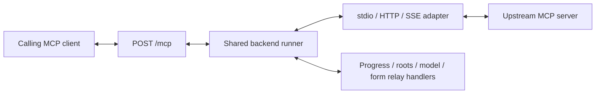

# Native MCP progress and interaction relay — approved presented behavior

October27, 2026. **Presented native relay behavior approved in D66.** D59 selects shared functions/runner, D61/D62 transports/routing and D64/D65 preserve valid raw data with explicit protocol presentation. D66 selects native progress/client-interaction relay with the shown ownership, capability, continuation and deadline boundaries. It does not imply resources/prompts/Tasks/GitHub scope, a new model provider, extra worker processes or application implementation.

## Scope and interfaces

Handle selected progress, roots/list, sampling/createMessage, elicitation/create and modern input_required continuation inside the existing /mcp runner/adapters. The originating MCP client owns the workspace context, model interaction and form/URL UI. Fetch relays supported native messages; it does not create a Fetch-owned model, form UI, filesystem-root fallback or credential entry channel.

Use the same backend invocation operation, identity mapping, authorization and execution controls as the existing APIs. Its trusted internal call context can carry native relay callbacks/control state outside the raw model argument object. The ordinary application POST /api/v1/servers/{server_id}/tools/{tool_name}/call remains D50's terminal-only synchronous JSON interface. It has no native interaction channel and does not gain streaming interaction/job/status/cancel APIs here. Known unsupported requirements reject before forwarding under existing409/not_started handling; unexpected unsupported interaction after forwarding retains truthful502/unknown/no-result handling where applicable. Do not fabricate completion or bypass API business rules in the native adapter.

A native-supported call may have progress/interaction protocol exchanges before its final result. The actual terminal upstream ToolResult still follows D43/D64: raw canonical HTTP value, raw native content/fields except the approved missing legacy marker. Intermediate control exchange is not a completed ToolResult or an automatic retry of an uncertain call.

## How the planned endpoint, runner and functions fit together

These are architectural roles, not implemented function names. The endpoint decodes/authenticates native messages and resolves aliases/control replies. The runner owns invocation identity, queue/deadline and caller context. Transport functions send/receive native messages to the configured server; relay handlers interpret supported protocol events and return client answers through that same transport operation. A provider's actual tool function stays upstream and receives the original argument object.

For example, a remote calendar tool is forwarded by the HTTP adapter. Its request to choose a calendar reaches the runner's elicitation handler, then the originating capable client's UI. The reply returns through /mcp to the matching pending operation and back through the HTTP adapter. The eventual terminal result retains the approved raw-data mapping. A progress event similarly returns through its owning call stream.

Existing backend installation/config/auth/credential/process/reconnect services are reused where their API operation requires them; the relay does not add another implementation of those services or silently trigger login/restart/store writes. The direct REST adapter continues using the same backend execution operation with its terminal-only interface.

## Capability and caller boundary

Enable a feature only when the negotiated upstream/downstream revisions, implemented adapter and actual caller can support it with provable ownership. Capability declaration is not authorization or automatic consent. Recheck caller grant/permission and applicable modes at dispatch/continuation; never combine different clients' capabilities into a union or borrow another caller's feature/context.

Modern upstream requests carry the supported caller-specific capability intersection. Legacy capabilities are fixed at initialization and cannot honestly change per call on one shared context. Use a conservative fixed supported set; leave an optional interaction capability off where ownership/caller-route support cannot be guaranteed. This proposal does not silently reinitialize a shared server, select a first-client owner, add private sessions/processes, or manufacture a dynamic legacy capability mechanism. Any supported legacy integration must establish that its advertised interaction modes actually work on the permitted route before claiming support.

## Progress

When the downstream request asks for progress through its native mechanism, create/maintain an upstream token mapping bound to caller, invocation/round, original target and connection generation. This is protocol correlation metadata, not an argument inserted into params.arguments; no new progress capability flag is invented. Relay available progress data to only the owning current request, translating correlation tokens as needed. A quiet tool need not generate events. Reject/drop unrelated or late tokens; do not broadcast, invent progress or replay buffered events to a new request.

Progress is not terminal completion and never resets the selected absolute Fetch execution deadline. Existing transport JSON/SSE rules and D47 revision-specific stream cancellation behavior remain. Exact rate/resource bounds remain implementation prerequisites, not a promise of unlimited buffering.

## Roots, sampling and elicitation

| Request | Native relay behavior |
| --- | --- |
| roots/list | Request workspace/root metadata from the originating capable client and return its permitted answer. Fetch does not invent an empty list, union all clients' projects or inspect local files as a fallback. Roots are guidance, not an OS sandbox. |
| sampling/createMessage | Send the model request to that capable client and return its native answer/error. No Fetch-owned LLM, provider key, substituted model or automatic approval. The client controls permitted context/consent. |
| elicitation/create | Ask that client to render its supported form/URL interaction and relay the actual answer, decline or cancel. No invented user response, alternate client's dialog or automatic URL navigation. |

Forms are for ordinary non-secret input: MCP prohibits asking for passwords/API keys/access tokens through form mode. Fetch must not use this relay as an alternative manual credential writer or treat arbitrary provider wording as proof of non-secret data. Known incompatible credential requests receive safe unsupported/appropriate Settings/auth handoff; no keyword filter is claimed to prove all server prompts safe. Supported client/integration behavior still requires verification. URL mode requires the client's explicit user consent; browser consent or an elicitation answer is not D25/D31 verified authentication. Provider credential ownership/store/readback/service-endpoint2xx requirements remain unchanged.

Forward actual decline/cancel as the requested interaction's native response; do not silently reinterpret it as a new tool command, a successful user choice or cancellation of unrelated work. A genuine invocation cancellation remains its separate protocol/execution event.

## Legacy ownership limitation

Legacy stdio messages and unrelated standalone HTTP GET-stream requests have no dependable standard parent-request field. One active call or the most recent client does not establish ownership. Do not invent _meta.relatedRequestId as a standard wire field or rely on an SDK convenience option without receiving-side association evidence.

A supported HTTP POST-stream adapter may preserve its parent request context; its selected SDK must actually expose/retain that association. The standard's SHOULD-related traffic statement alone is not implementation proof. An explicit supported integration can provide equivalent ownership where reviewed. Otherwise, answer that unowned server request with a safe native unsupported/context-unavailable error, without consulting any client, model or filesystem. Do not guess and fail/cancel an unrelated active call. If the provider cannot proceed, report its actual subsequent outcome or the existing timeout/readiness result.

These limitations can restrict older servers' interactive behavior even though their ordinary tools/progress work. Do not advertise unrestricted legacy relay or overall real-use compatibility before the actual isolated acceptance set passes.

## Modern continuation and cross-era control frames

Modern input_required is an intermediate control result. Use a Fetch-owned opaque continuation handle bound privately to authenticated client/grant context, original server/tool and arguments, connection generation, expected input keys, original opaque upstream state (including absence), and expiry. A client echoes Fetch's handle; Fetch restores the provider's original requestState exactly without inspecting/parsing/modifying it. Fetch acts as a server on one hop and client on the other; its own handle is not the upstream blob rewritten in place.

D66 explicitly permits adapting intermediate requestState/request/input-response correlation fields, outside the preserved terminal ToolResult and raw model arguments. It prevents collisions when distinct operations receive identical or missing provider state. Exact opaque-handle/key/storage representation remains implementation work; no provider token export or persistent job/result record is selected.

Validate ownership, original target/arguments, permissions, expected input keys, generation and expiry before forwarding. Guard duplicate concurrent continuation and reject cross-owner, expired, consumed or ambiguous handles with safe native failure. Do not retarget another server/tool or execute a changed argument object. Each permitted continuation uses fresh per-hop JSON-RPC IDs and returns inputResponses under the correct request-local keys. It is a continuation of the original operation, not replay of its initial action after an uncertain failure.

Translate modern input requests to supported legacy callbacks, or correlated legacy callbacks to modern continuation control, only where the adapter can preserve actual caller ownership/modes. Do not present an unimplemented cross-era feature as available, strip meaningful unsupported control data, or pretend an intermediate response is a terminal raw result. Capability/ownership failure uses safe existing native/Fetch failure handling; numeric SDK/protocol mappings remain their review topic rather than invented reserved errors.

## Deadline, cancellation and lifecycle

Keep one logical operation across rounds: no new queue admission, fresh timeout budget or premature completion/released reservation just because input_required was returned. Handle eligibility expires at the original effective call deadline or an earlier valid protocol expiry. Waiting for client input uses that same deadline; existing configurable per-server/per-tool durations can accommodate slower interactions, but progress/input does not automatically extend it.

Grant/session/context invalidation prevents later resume. Terminal completion/expiry/approved recovery retires associated relay handles/tokens. Ordinary uncertainty/occupied-capacity/drain resolution still follows the execution contract; its remaining detailed policies are not silently selected by this relay proposal. Cancelling a local waiter/stream is not proof that external work stopped or was rolled back.

Distinguish a normal completed MRTR response stream from abandoning a still-pending request. An input_required round can finish normally while the logical operation awaits a later request. Do not interpret every normal round-trip end as cancellation or assume a client that disappears between rounds sent a cancellation signal. D47's modern pending-stream/legacy disconnect rules still apply; abandoned flow state expires under the existing deadline.

No automatic callback/call replay, server restart, duplicate client, browser consent or cross-Quit continuation recovery. Native endpoints retain protocol framing; ordinary UI installation/auth/restart still uses structured API state and deterministic sequencing, not next_steps text. Shared upstream process/browser/cache state remains shared under the selected one-process design: correct reply routing does not establish OS/provider-state isolation.

## Research, unresolved work and future evidence

Read-only primary research inspected [legacy transports](https://modelcontextprotocol.io/specification/2025-11-25/basic/transports), [SEP-2260 legacy association limitation](https://github.com/modelcontextprotocol/modelcontextprotocol/blob/ccaf9102ec5eb656eab50ca8333ef49dcd259c26/seps/2260-Require-Server-requests-to-be-associated-with-Client-requests.md), [TS transport interface](https://github.com/modelcontextprotocol/typescript-sdk/blob/v2.4.0/packages/core-internal/src/shared/transport.ts) and [HTTP client](https://github.com/modelcontextprotocol/typescript-sdk/blob/v2.4.0/packages/client/src/client/streamableHttp.ts). SDK relatedRequestId send options are not proof of a standard stdio parent field or preserved receive association.

[Modern versioning](https://modelcontextprotocol.io/specification/2026-07-28/basic/versioning), [legacy capability setup](https://modelcontextprotocol.io/specification/2025-11-25/basic/lifecycle), [MRTR](https://modelcontextprotocol.io/specification/2026-07-28/basic/patterns/mrtr), [progress](https://modelcontextprotocol.io/specification/2026-07-28/basic/patterns/progress), [elicitation](https://modelcontextprotocol.io/specification/2026-07-28/client/elicitation) and [roots](https://modelcontextprotocol.io/specification/2026-07-28/client/roots) support the constraints above. Reuse prior active licensed SDK/gateway and client capability audits; no new dependency chosen or code copied. Claude/OpenCode source facts are not proof that installed clients/servers pass; no provider or personal-client probe was performed.

D67 subsequently approves presented resources/prompts and explicit native Tasks/live-content deferrals. GitHub CLI and remaining execution/auth/destination/TLS/crypto/storage/resource mechanisms remain separate explicit reviews. After implementation authorization, D46 isolated tests must cover all supported revision directions, capability honesty, owned/unowned callbacks, same IDs/tokens/states across clients, startup/background requests, real client answers/declines/cancels, MRTR replay/expiry/generation/argument checks, progress without timer reset, direct REST unsupported handling, no fallback access, raw terminal fidelity and shared-state limitations. No runtime tests, environments, services, dependencies, personal configuration or credentials were changed in this pass.

The [resources/prompts proposal](mcp-resources-prompts.md) explicitly proposes reusing D66 ownership/continuation/progress for resource reads and prompt retrieval where supported; bind the actual method/target rather than assuming a Tool name. D67 accepts the presented native resource/prompt surface; exact ownership/handle/codec implementation and runtime evidence remain open.
